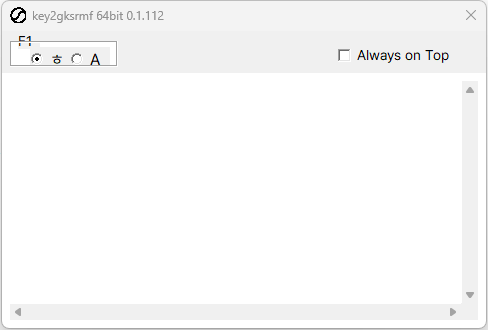

  
  <b>key2gksrmf</b>

  
  

## プレビュー

  

## 概要

| 項目 | 内容 |
|---|---|
| プロジェクト名 | key2gksrmf |
| サービス名 | 物理キーをハングルに変換 |
| 対象ユーザー | 韓国語キーボードレイアウトがない Windows ユーザー |
| プラットフォーム | Windows 10/11 (Win32 ネイティブ) |

QWERTY 物理キーを二式（두벌식）ハングルにリアルタイム変換するトレー常駐アプリです。インストール不要の単一 exe で動作します。

## 主な機能

- 物理キー基準の二式ハングル入力（例: `gksrmf` → `한글`）
- `F1` またはステータスバーの `ㅎ` / `A` で韓/英モード切り替え
- 単語折り返し（Wrap）、Always on Top、行番号ガター
- トレー常駐（閉じても終了せず非表示）、二重起動防止
- 設定は exe と同じフォルダの `config.json` に保存

## Web デモ

**[GitHub Pages](https://noelfania.github.io/key2gksrmf/)** でブラウザ版エディタを試せます。

Type Hangul with physical QWERTY keys — no Korean IME required.  
한글 자판·IME 없이 영문 키보드로 두벌식 한글 입력（예: `gksrmf` → `한글`）.

- `F1` または `ㅎ / A` で韓/英モード切り替え
- Windows ネイティブ版のダウンロードは下記 Releases を利用

## ダウンロード

**[GitHub Releases](https://github.com/noelfania/key2gksrmf/releases)** から `key2gksrmf-v*-win64.zip` をダウンロードし、解凍して `key2gksrmf.exe` を実行してください。

> **Edge でのダウンロードについて**  
> `.exe` 単体は SmartScreen によりダウンロード自体がブロックされることがあります。  
> そのため Releases では zip のみ配布しています。zip は通常ダウンロードできます。  
> 初回実行時は「詳細情報」→「実行」で起動してください（未署名 exe のため）。

初回実行時、exe と同じフォルダに `config.json` が作成されます。

開発者向け（ビルド・リリース・Pages）: [doc/dev-guide.md](doc/dev-guide.md)  
詳細設計・サービス仕様: [doc/app-detailed-design.md](doc/app-detailed-design.md)

