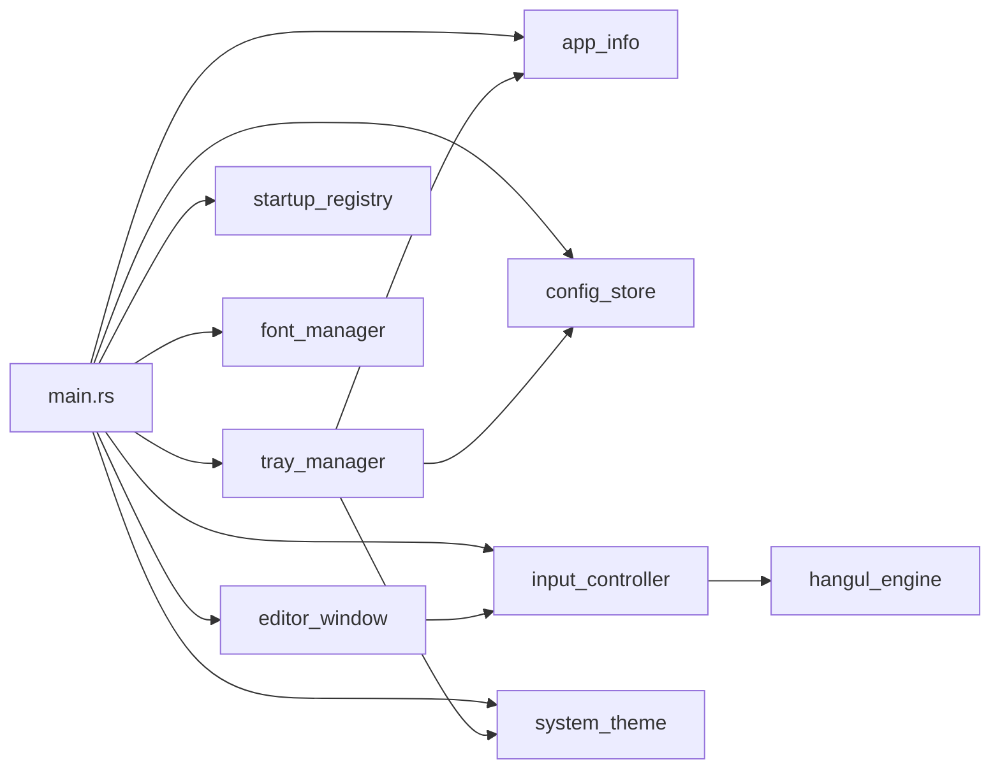
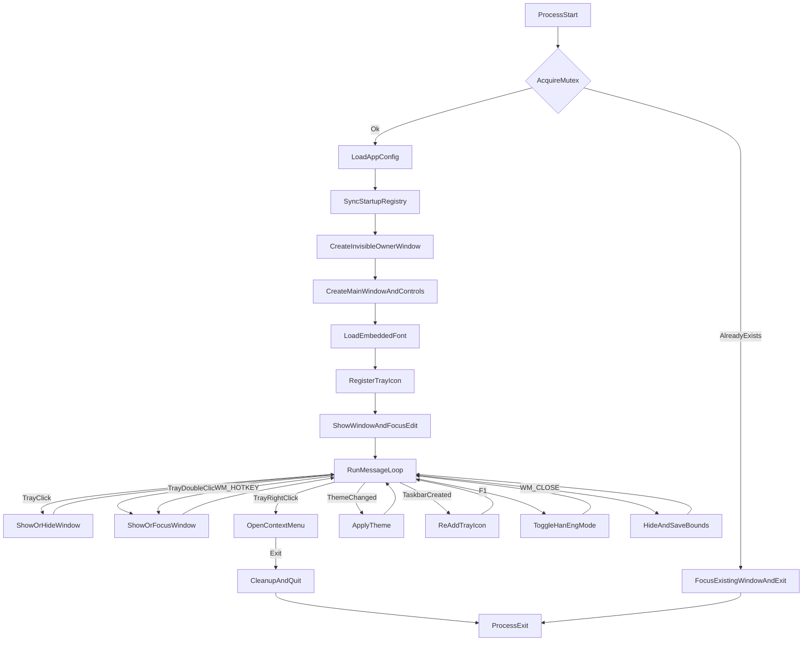
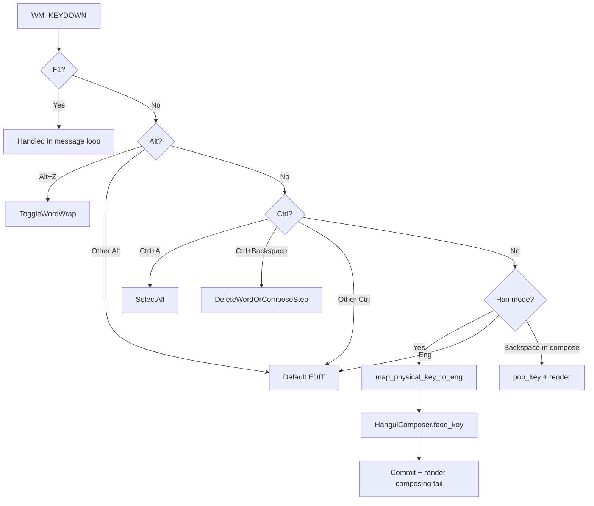

# key2gksrmf — 동작 구조 및 기능 사양 (상세설계)

> 대상: Windows 10/11 Win32 네이티브 단일 프로세스 트레이 앱
>
> 기준: 현재 구현 상태 (`Cargo.toml` version)
>
> **서비스사양**: [.cursor/rules/project-standards.mdc](../.cursor/rules/project-standards.mdc)

---

## 1. 목적 및 범위

### 1.1 목적

- 한글 키보드 레이아웃이 설치되지 않은 환경에서도 QWERTY 물리키로 두벌식 한글 입력이 가능하도록 한다.
- 트레이 상주형 경량 앱으로 실행 후 즉시 입력창에서 타이핑할 수 있게 한다.
- 웹뷰·대형 런타임 없이 Rust + Win32로 포터블하게 동작한다.

### 1.2 In-Scope

- 입력 창 포커스 안에서 `WM_KEYDOWN` 물리키 → 두벌식 한글 완성형 조합
- 한/영 모드 전환 (상단바 `한`|`A` 세그먼트 클릭, F1)
- 상단바 Wrap 토글(Alt+Z), 항상 위 토글, 트레이 컨텍스트 메뉴
- Windows 라이트/다크 테마·강조색 추종 (실행 중 전환 즉시 반영), 모니터별 DPI(PerMonitorV2)
- 설정 영속화(JSON), 창 위치·크기 저장, 시작 프로그램 레지스트리 동기화
- 단일 인스턴스(mutex), 전역 단축키 Ctrl+Alt+Shift+G 창 열기(기본 off)
- 내장 한글 폰트 (Pretendard Regular)
- Windows 표준 Unicode 클립보드 복사/붙여넣기

### 1.3 Out-of-Scope

- 웹/모바일/크로스플랫폼 GUI 프레임워크 전환
- 계정, 동기화, 클라우드 저장
- macOS/Linux 포팅
- 전역 물리키 훅 (다른 앱 포커스에서의 입력 변환)
- UTF-8 바이트 전용 클립보드 복사 (별도 기능으로만 검토)

### 1.4 런타임 특성

- Rust 2021, Win32 `W` API
- 단일 실행 파일, 무설치(포터블) 지향
- 릴리스: `lto`, `strip`, `opt-level = "z"`

---

## 2. 핵심 설계 결정

### 2.1 입력 모델 (현재 구현)

- **물리키 기반 조합**을 사용한다. `EDIT` subclass `edit_proc`에서 `WM_KEYDOWN`을 가로채 `KeyEvent`로 만들고 `InputController::handle_key`에 넘긴다.
- `InputController`(`src/input_controller.rs`)는 Win32를 모르는 상태 기계다. 모드, 조합 시작 위치(UTF-16), WM_CHAR 억제 플래그를 갖고 `TextBuffer` 트레이트(선택·치환)로만 텍스트를 다룬다. 운영에서는 `editor_window::EditBuffer(HWND)`, 테스트에서는 메모리 버퍼와 실제 EDIT를 쓴다.
- `map_physical_key_to_eng`로 가상키를 두벌식 영문 키로 매핑한 뒤 `HangulComposer::feed_key`에 전달한다. Alt가 눌린 키(`WM_SYSKEYDOWN`)는 조합하지 않는다.
- 조합 중 텍스트는 `EM_REPLACESEL`로 선택 영역만 갱신하고, 확정분(`committed`)은 즉시 커밋한다.
- 초기 `EN_CHANGE` 후처리 방식은 제거했다. (`doc/issues/01-input-model-physical-key.md` 참고)

### 2.2 조합 tail 분리

- Backspace 시 전체 키 버퍼 재변환으로 앞 음절이 오염되는 문제를 막기 위해 `ComposerStep { committed, composing }`를 사용한다.
- `pop_key()`는 마지막 키 1타만 되돌린다. 예: `한국어이` → Backspace → `한국어ㅇ`.

### 2.3 한/영 모드

- 오른쪽 Alt 토글은 Windows 시스템 키 충돌로 **채택하지 않음**.
- 상단바 `한` | `A` 세그먼트 클릭(또는 옆의 `F1` 배지 클릭), **F1**으로 전환. F1은 메시지 루프 한 곳에서 처리한다.
- 한 모드: 물리키 조합. 영 모드: 기본 `EDIT` 동작에 위임.

### 2.4 문자 인코딩 및 클립보드 정책

- 앱 내부: Rust `String` (UTF-8)
- Win32 `EDIT` / `W` API: UTF-16
- 클립보드: Windows 표준 `CF_UNICODETEXT` (UTF-16LE)
- 기본 `Ctrl+C`는 표준 유니코드 텍스트 복사 유지. UTF-8 바이트가 필요하면 별도보내기 기능으로 검토.

### 2.5 폰트

- Pretendard Regular를 `include_bytes`로 내장, `AddFontMemResourceEx` 등록 후 `WM_SETFONT` 적용.
- 적용 대상: 에디터(`EDIT`), 상단바 `한`/`A` 글자. 높이는 DPI에 비례(96 DPI에서 16px), `WM_DPICHANGED` 시 재생성.
- 상단바 아이콘은 Segoe Fluent Icons(Win10은 Segoe MDL2 Assets), 단축키 배지는 Segoe UI.
- 등록 실패 시 시스템 기본 폰트 fallback.

---

## 3. 모듈 구조 및 책임



| 모듈 | 파일 | 역할 |
|---|---|---|
| 앱 진입점 | `src/main.rs` | `wnd_proc`, `edit_proc`(얇은 껍데기), 메시지 루프, 테마·DPI 적용, 단일 인스턴스 |
| 입력 컨트롤러 | `src/input_controller.rs` | 키 이벤트 → 조합·편집 (`InputController`, `TextBuffer`), 테스트 하네스(`input_controller/tests.rs`) |
| 시스템 테마 | `src/system_theme.rs` | 앱/작업 표시줄 라이트·다크, 강조색, 제목 표시줄 색, 다크 메뉴 허용 |
| 앱 식별자 | `src/app_info.rs` | 앱 이름, 창/owner 클래스, mutex 이름, 타이틀, 단축키 표시 문자열 |
| 트레이 | `src/tray_manager.rs` | 아이콘 등록·재등록, 테마·DPI별 아이콘, 컨텍스트 메뉴, 창 표시/포커스 |
| 에디터 창 | `src/editor_window.rs` | 팔레트, 상단바(`k2g_toolbar`)·거터(`k2g_gutter`)·EDIT 생성·리사이즈, DPI 배율 |
| 한글 엔진 | `src/hangul_engine.rs` | `HangulComposer`, `convert_eng_to_kor`, 조합 테이블 |
| 설정 | `src/config_store.rs` | `config.json` 로드/저장 |
| 시작 프로그램 | `src/startup_registry.rs` | `HKCU\...\Run` 등록/해제 |
| 폰트 | `src/font_manager.rs` | 내장 폰트 메모리 등록, `HFONT` 생성·해제 |

> 입력 처리 로직은 `input_controller.rs`에 있고, `main.rs`의 `edit_proc`은 메시지를 `KeyEvent`로 바꿔 넘기기만 한다.

---

## 4. 기동~종료 생명주기



---

## 5. UI 상세 설계

### 5.1 메인 창

- 기본 크기: 500×500 (`config.json`에서 복원 가능)
- 최초 실행: 창 표시 + 에디터 포커스
- 닫기·최소화: 트레이로 숨김 (종료 아님), 위치·크기 저장
- 작업 표시줄: 미표시 (invisible owner 창 패턴)
- 리사이즈: `WS_THICKFRAME`, 거터·에디터는 창 가장자리까지 여백 없이 배치
- 최소 창 폭: 상단바 컨트롤이 겹치지 않도록 `WM_GETMINMAXINFO`로 제한 (`AdjustWindowRectExForDpi`)
- DPI: 매니페스트 PerMonitorV2. 치수는 96 DPI 기준 값을 `editor_window::px()`로 환산, `WM_DPICHANGED`에서 폰트·아이콘·레이아웃 재계산
- 테마: `AppsUseLightTheme`에 따라 다크 제목 표시줄(`DWMWA_USE_IMMERSIVE_DARK_MODE`), 다크 팔레트, 다크 스크롤바·툴팁(`SetWindowTheme("DarkMode_Explorer")`). `WM_SETTINGCHANGE("ImmersiveColorSet")`·`WM_DWMCOLORIZATIONCOLORCHANGED`에서 즉시 재적용
- 창 아이콘: 제목 표시줄이 어두우면(다크 모드 또는 어두운 강조색 제목 표시줄) 흰 '나'(102), 아니면 검은 '나'(101). `WM_SETICON`으로 DPI 크기에 맞춰 설정
- 타이틀: `key2gksrmf 64bit {version}` (`app_info::window_title`)
- 단일 인스턴스: mutex `Local\\key2gksrmf_single_instance` (디버그 빌드는 `_debug` 접미사로 별도 인스턴스)

### 5.2 상단바 (높이 36px @96DPI)

커스텀 그리기 자식 창 `k2g_toolbar` 하나로 그린다 (메모리 DC 더블버퍼, 도형은 GDI+ 안티앨리어싱, 글자는 GDI ClearType). 테마 버튼 컨트롤을 쓰지 않으므로 다크 모드 색을 그대로 적용할 수 있다.

```
╭────┬────╮ [F1]                 ╭──────────╮ ╭───╮
│ 한 │ A  │                      │ ↵ [Alt+Z]│ │ 📌│
╰────┴────╯                      ╰──────────╯ ╰───╯
```

| 영역 | 클릭 시 `WM_COMMAND` | 설명 |
|---|---|---|
| `한` 칸 | `IDC_MODE_HAN` (2002) | 세그먼트, 선택 칸은 강조색 배경 |
| `A` 칸 | `IDC_MODE_ENG` (2003) | |
| `F1` 배지 | 현재 모드의 반대 | 단축키 표시 겸 토글 |
| Wrap (↵ `E751`) + `Alt+Z` 배지 | `IDC_WORD_WRAP_CHECK` (2004) | 켜짐: 옅은 강조색 배경 + 강조색 아이콘 |
| 투명도 (`E793`) | `IDC_OPACITY_BUTTON` (2006) | 슬라이더 팝업 토글. 투명도 > 0이면 켜짐 표시, 툴팁에 현재 % |
| 항상 위 (핀 `E718`/`E840`) | `IDC_ALWAYS_ON_TOP_CHECK` (2001) | 트레이 메뉴와 동기화 |

- 상태는 `editor_window::toolbar_set_state(han, wrap, topmost, transparency)`로 반영 (`main::sync_toolbar`)
- hover/press는 `TrackMouseEvent`·`SetCapture`로 추적, 눌렀다 같은 영역에서 떼면 실행
- 창이 좁아 모두 들어가지 않으면 단축키 배지부터 숨긴다 (툴팁에는 계속 단축키 표시)
- 툴팁: `tooltips_class32` 하나에 영역별 rect 도구(`TTF_SUBCLASS`), 리사이즈 시 `TTM_NEWTOOLRECTW`
- 단축키 문자열은 `app_info::SHORTCUT_*` 상수 하나로 배지·툴팁·트레이 메뉴가 공유

### 5.3 입력 영역

- Win32 멀티라인 `EDIT` (`ES_MULTILINE`, `ES_AUTOVSCROLL`, `ES_WANTRETURN`)
- `word_wrap=true`(기본): 가로 스크롤 없음 → 창 너비 초과 시 자동 줄바꿈
- `word_wrap=false`: `WS_HSCROLL` + `ES_AUTOHSCROLL`로 가로 스크롤
- Wrap 토글 시 `ES_AUTOHSCROLL`은 생성 후 변경 불가이므로 EDIT를 재생성하고 텍스트·선택을 이관
- `edit_proc` subclass로 키 입력 가로채기
- `EM_SETLIMITTEXT(0)`으로 기본 입력 한도(32,767자) 해제
- 내장 폰트 `WM_SETFONT` 적용
- `WM_ACTIVATE` 시 에디터에 자동 포커스 (Alt+Tab 복귀 후 즉시 타이핑 가능)

#### 레이아웃·구분선

- 거터·에디터는 창 가장자리까지 여백 없이 채운다 (외곽 마진 없음)
- 구분선 2종 (팔레트 `separator` 1px):
  - 상단바↔에디터: 상단바 맨 아래, `paint_toolbar`에서 그림
  - 거터↔에디터: 거터 오른쪽 끝, `paint_gutter`에서 그림
- 에디터 첫 행 여백: `EM_SETRECT`로 포맷 영역에 상단 6px·왼쪽 4px 인셋 (DPI 비례).
  `WM_SIZE`·`WM_SETFONT`가 포맷 영역을 재계산하므로 리사이즈·폰트 적용 후 재호출 필요

#### 행 번호 거터 (폭 44px @96DPI)

- 에디터 왼쪽에 자체 window class(`k2g_gutter`)의 자식 창을 배치하고 `WM_PAINT`에서 직접 그린다
- `EM_GETFIRSTVISIBLELINE` → `EM_LINEINDEX`로 시각행 시작 문자 인덱스를 얻고, 그 이전 개행 수로 **논리 행 번호** 계산
- Wrap으로 꺾인 연속 시각행에는 번호를 표시하지 않음 (논리 행 첫 시각행에만 표시)
- **현재 커서 행 강조**: `EM_GETSEL` 캐럿 위치의 논리 행 번호를 상단바와 같은 accent 색 굵은 글씨(에디터 폰트 `LOGFONTW`에서 `FW_BOLD`로 만든 폰트)로, 나머지는 `line_number` 색으로 표시
- **숫자 고정 폭**: 일반·굵은 폰트에서 `0`~`9` 중 가장 넓은 폭을 칸 폭으로 잡고 숫자를 한 글자씩 칸 가운데에 그려 자릿수 정렬을 맞춘다 (비례폭 폰트에서 `1`이 좁아 `11`이 치우치는 문제)
- **클릭 시 행 선택**: `WM_LBUTTONDOWN`에서 y를 시각행으로 바꿔 부모에 `WM_COMMAND(IDC_GUTTER_LINE)`을 보내고, 메인 창이 조합을 확정한 뒤 그 시각행이 속한 논리 행 전체(개행 제외, 캐럿이 그 행에 남아 강조도 유지)를 선택해 에디터로 포커스를 돌린다
- 행 높이는 에디터 폰트(`WM_GETFONT`)의 `GetTextMetricsW` 기준, `EM_GETRECT` 상단 오프셋으로 정렬 (에디터 상단 패딩과 자동 동기화)
- 갱신: `EN_CHANGE`/`EN_VSCROLL`, `WM_SIZE`, `edit_proc`의 키·마우스·스크롤 처리 후 `InvalidateRect`

#### 색상 테마 (`AppConfig.colors` / `colors_dark`)

| 설정 키 | 대상 | 라이트 기본 | 다크 기본 |
|---|---|---|---|
| `gutter_background` | 거터 배경 | `#F3F3F3` | `#202020` |
| `line_number` | 행 번호 텍스트 | `#8A8A8A` | `#7A7A7A` |
| `status_bar` | 상단바 배경 | `#F3F3F3` | `#202020` |
| `editor_background` | 에디터 배경 | `#FFFFFF` | `#1C1C1C` |

- 라이트 모드는 `colors`, 다크 모드는 `colors_dark`(기본 비어 있음)로 덮어쓴다. `"#RRGGBB"`, 없거나 파싱 실패 시 내장 팔레트
- 이전 버전 기본값(`#F0F0F0`, `#6E6E6E`)은 사용자가 바꾸지 않은 값으로 보고 새 기본값으로 이전한다
- 본문 글자·보조 글자·hover·배지 테두리 등은 팔레트 고정. 강조색은 `HKCU\Software\Microsoft\Windows\CurrentVersion\Explorer\Accent\AccentPalette`(라이트: Dark 1, 다크: Light 2)
- `editor_window::init_theme(cfg, dark, accent)`가 브러시를 (재)생성, `WM_CTLCOLOREDIT`·`paint_toolbar`·`paint_gutter`에서 사용, 종료 시 `editor_window::cleanup`

### 5.4 항상 위

- `WS_EX_TOPMOST` / `SetWindowPos(HWND_TOPMOST)` 토글
- 상단바 핀 토글·트레이 메뉴·`AppConfig.always_on_top` 동기화

#### 창 투명도 (`window_opacity.rs`)

- `AppConfig.transparency` (0~80%, 상한 `config_store::MAX_TRANSPARENCY`). 0이면 `WS_EX_LAYERED`를 떼고, 그 외에는 `SetLayeredWindowAttributes(LWA_ALPHA)`로 창 전체(글자 포함)에 같은 알파를 준다
- 슬라이더 팝업: 메인 창을 owner로 하는 `WS_POPUP`(항상 위면 `WS_EX_TOPMOST`도) + `msctls_trackbar32`(0~80, 페이지 10). 끄는 동안 `set_transparency(save=false)`로 미리보기, 닫힐 때 한 번 저장
  - 닫기: 바깥 클릭(`WA_INACTIVE` → `WM_CLOSE` 게시)·Enter는 확정, Esc는 연 시점 값으로 되돌림 (메시지 루프의 `window_opacity::pre_translate`)
  - 바깥 클릭이 투명도 버튼이면 닫힌 직후 300ms 동안 다시 열지 않는다 (같은 클릭으로 재오픈 방지)

### 5.5 트레이

`NOTIFYICON_VERSION_4`로 등록한다 (키보드 Win+B 접근, `WM_CONTEXTMENU` 기준 좌표).

| 동작 | 결과 |
|---|---|
| 클릭 / Enter (`NIN_SELECT`·`NIN_KEYSELECT`) | 창이 앞에 있었으면 숨김, 아니면 표시·포커스. 직전 비활성 시각이 500ms 이내면 "앞에 있었다"로 판단하고, 더블클릭의 두 번째 클릭은 무시 |
| 더블클릭 | 창 표시 및 포커스 |
| 우클릭 / Shift+F10 | 컨텍스트 메뉴 |

```
Open key2gksrmf        Ctrl+Alt+Shift+G   ← 굵은 기본 항목, 창이 보이면 "Hide key2gksrmf"
──────────────────
✓ Always on Top
✓ Word Wrap            Alt+Z
──────────────────
✓ Global Hotkey (Ctrl+Alt+Shift+G)
✓ Start with Windows
──────────────────
GitHub
Exit
```

- 단축키 텍스트는 탭 문자 뒤에 써서 오른쪽 정렬. Open 항목의 단축키는 전역 단축키가 켜져 있을 때만 표시
- `TrackPopupMenu` 뒤 `PostMessage(WM_NULL)` (메뉴가 닫히지 않는 문제 방지)
- 다크 메뉴: uxtheme ordinal 135 `SetPreferredAppMode(AllowDark)`, 테마 변경 시 136 `FlushMenuThemes`. 비공개 API라 실패해도 무시
- 아이콘: 작업 표시줄 테마(`SystemUsesLightTheme`)에 따라 검은/흰 '나', `LoadIconMetric(LIM_SMALL)`로 DPI 크기
- 툴팁: `key2gksrmf` (입력 모드는 표시하지 않음)
- 탐색기 재시작(`TaskbarCreated`) 시 아이콘 재등록

### 5.6 전역 단축키 (Ctrl+Alt+Shift+G)

- `RegisterHotKey(hwnd, HOTKEY_ID_OPEN, MOD_CONTROL | MOD_ALT | MOD_SHIFT | MOD_NOREPEAT, 'G')`
- `WM_HOTKEY` 수신 시 창 표시(`SW_RESTORE`) + 에디터 포커스 → 즉시 타이핑 가능
- 트레이 메뉴 `Global Hotkey (Ctrl+Alt+Shift+G)` 체크로 on/off, 기본 **off**
- 등록 실패(다른 앱 선점) 시: 토글에서는 메시지박스 안내, 시작 시에는 조용히 설정 원복
- `AppConfig.global_hotkey_open`에 영속화

---

## 6. 실시간 변환 엔진 설계

### 6.1 API

| API | 용도 |
|---|---|
| `HangulComposer::feed_key(key) -> ComposerStep` | 물리키 1타 입력, committed/composing 분리 반환 |
| `HangulComposer::pop_key() -> String` | 마지막 키 1타 되돌림 |
| `convert_eng_to_kor(&str) -> String` | 문자열 일괄 변환 (테스트·레거시) |

### 6.2 조합 테이블

- `ENG_KEY`, `KOR_KEY`, `CHO_DATA`, `JUNG_DATA`, `JONG_DATA`
- 완성형: `0xAC00 + cho * 21 * 28 + jung * 28 + jong`

### 6.3 입력 처리 흐름 (`edit_proc` → `InputController::handle_key`)



### 6.4 엔진 모듈 경계

- `hangul_engine`는 Win32, 트레이, 파일 I/O를 모르는 순수 로직 모듈
- `input_controller`도 Win32 메시지를 모른다 (`TextBuffer`·`KeyEvent`만 사용)
- 테스트: `cargo test` (10장 참고)

---

## 7. 설정 및 저장 설계

### 7.1 AppConfig 스키마

```json
{
  "always_on_top": false,
  "start_with_windows": false,
  "word_wrap": true,
  "global_hotkey_open": false,
  "transparency": 0,
  "colors": {
    "gutter_background": "#F3F3F3",
    "line_number": "#8A8A8A",
    "status_bar": "#F3F3F3",
    "editor_background": "#FFFFFF"
  },
  "colors_dark": {},
  "window": {
    "x": 100,
    "y": 100,
    "width": 500,
    "height": 500
  }
}
```

- `x`, `y`는 optional. 없거나 유효 모니터 밖이면 `CW_USEDEFAULT`
- `word_wrap` 기본값: `true` (기존 config에 없으면 자동 줄바꿈)
- `global_hotkey_open` 기본값: `false` (전역 단축키 미등록)
- `colors`·`colors_dark`의 각 키는 optional `"#RRGGBB"`. 없거나 형식이 잘못되면 내장 팔레트로 폴백 (5.3 색상 테마 참고)

### 7.2 저장 규칙

- 경로: 실행 파일과 같은 디렉터리의 `config.json`
- 저장 시점: 항상 위/시작 시 기동/Wrap/전역 단축키 토글, 창 숨김·종료·destroy 시 위치·크기
- 파싱 실패: `.json.bak` 백업 후 기본값

---

## 8. 시작 프로그램 레지스트리

- 키: `HKCU\Software\Microsoft\Windows\CurrentVersion\Run`
- 값 이름: `key2gksrmf` (legacy `gksrmf` 값은 시작 시 정리)
- 값: 따옴표로 감싼 현재 exe 경로
- 앱 시작 시 `AppConfig`와 레지스트리 정합성 동기화. 켜져 있으면 매번 현재 경로로 다시 써서 exe를 옮겨도 따라간다
- 디버그 빌드는 레지스트리를 건드리지 않는다 (개발 중 실제 등록이 지워지는 것 방지)
- 토글 실패 시 설정 롤백 + 메시지박스

---

## 9. 오류 처리 및 복원

| 상황 | 처리 |
|---|---|
| 설정 파일 없음 | 기본값으로 기동 |
| JSON 파싱 실패 | 백업 후 기본값 |
| 레지스트리 실패 | 알림, 체크 상태 원복 |
| 폰트 등록 실패 | 기본 폰트 fallback, 앱 계속 실행 |

---

## 10. 테스트 및 검증

### 10.1 자동 테스트 (`cargo test`)

- `hangul_engine`: 조합, 겹받침/복모음, pop_key
- `input_controller`: 물리키 매핑, Ctrl+Backspace 경계
- **에디터 시나리오** `tests/editor_cases.txt`: 시작 상태·키 입력·기대 결과를 적은 케이스를 **메모리 버퍼**와 **실제 Win32 EDIT**(숨김 창, 운영과 같은 `create_edit_control`) 양쪽에서 실행. 조합·Backspace·F1·캐럿 이동·클릭·붙여넣기·선택 덮어쓰기·Ctrl+BS·Alt 키 포함
- 긴 문서(4만 자)에서 계속 입력되는지 (실제 EDIT)
- `config_store`: 색상 파싱, 기본값, 이전 기본값 마이그레이션
- 입력 코드를 고친 뒤에는 `/editor-test` 스킬(`.claude/skills/editor-test/SKILL.md`)로 실행·보고

### 10.2 빌드

```bash
cargo test
cargo build --release
```

### 10.3 수동 점검 (미확인 항목)

- 조합 중 Undo/Redo (`doc/issues/08-open-checks.md`)
- 실제 125%/150% 배율 모니터에서 레이아웃·선명도, 모니터 간 이동
- SmartScreen, 타 PC 배포

---

## 11. 소스 맵

| 관심사 | 파일 |
|---|---|
| 앱 시작점·메시지 처리·테마/DPI 적용·단일 인스턴스 | `src/main.rs` |
| 키 입력 → 조합·편집 | `src/input_controller.rs` |
| 에디터 시나리오 테스트 | `src/input_controller/tests.rs`, `tests/editor_cases.txt` |
| 라이트/다크·강조색 감지 | `src/system_theme.rs` |
| 앱 이름·창 클래스·타이틀·단축키 문자열 | `src/app_info.rs` |
| 트레이 | `src/tray_manager.rs` |
| 상단바·거터·EDIT·팔레트·DPI | `src/editor_window.rs` |
| 한글 엔진 | `src/hangul_engine.rs` |
| 설정 | `src/config_store.rs` |
| 시작 프로그램 | `src/startup_registry.rs` |
| 내장 폰트 | `src/font_manager.rs` |
| 폰트 에셋 | `assets/fonts/Pretendard-Regular.ttf`, `OFL.txt` |
| 아이콘·매니페스트 | `assets/icons/`, `assets/app.manifest` (빌드 시 embed-resource) |

---

## 12. 관련 문서

- [서비스사양](../.cursor/rules/project-standards.mdc) — 목적, 범위, 기능 요약, 모듈 개요
- [개발·빌드·릴리스 가이드](dev-guide.md)
- [개발 이슈 정리](issues/issues.md) — 고민·해결·보류·미확인
- [README](../README.md) — 사용자용 소개 (일본어)

문서는 구현 변경 시 서비스사양·본 문서(상세설계)·코드를 함께 갱신한다.
